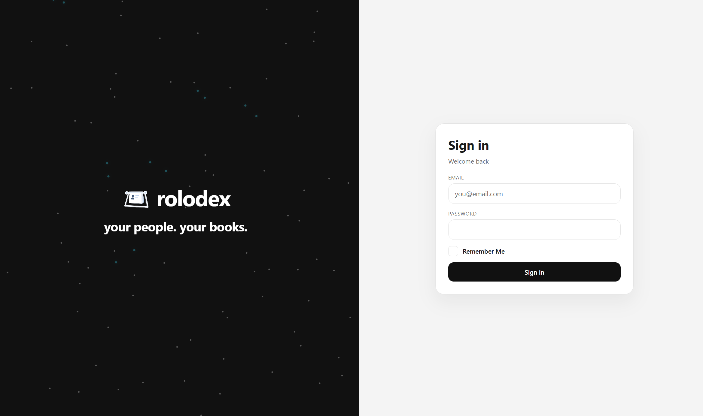
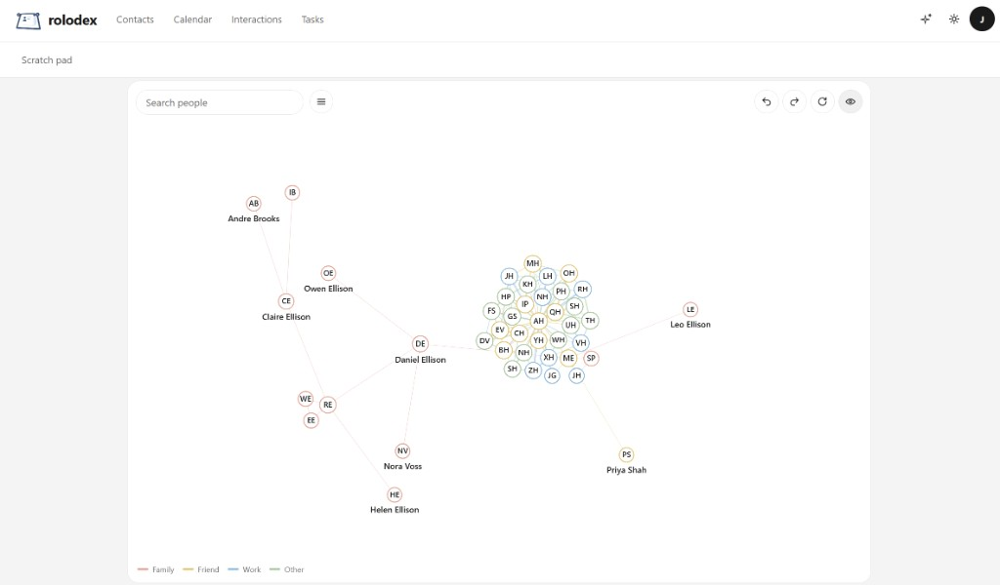
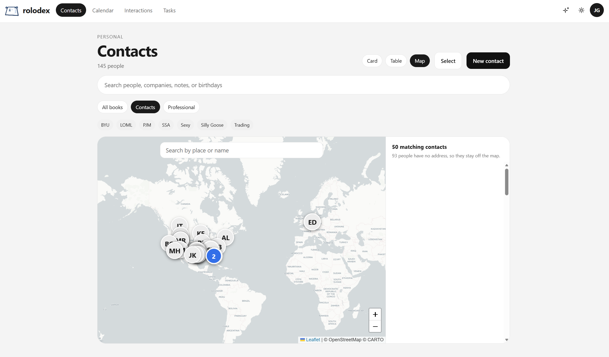

# Rolodex

[](LICENSE)
[](https://hub.docker.com/r/gallinij/rolodex)
[](https://hub.docker.com/r/gallinij/rolodex)
[](https://github.com/Rolodex-PRM/rolodex/stargazers)
[](https://github.com/Rolodex-PRM/rolodex/commits/main)
[](https://rolodex-prm.github.io/rolodex/)

**THIS IS UNDER ACTIVE DEVELOPMENT**

Rolodex is a self-hosted relationship manager. One server holds the people, the calendar, the tasks, and the history. A phone or computer syncs the address book through CardDAV and the calendar and tasks through CalDAV. Photos can stay in Immich. An owner can also check an outside mailbox and calendar.

Product site: [rolodex-prm.github.io/rolodex](https://rolodex-prm.github.io/rolodex/) (served from [`docs/`](docs/)).

The first visit creates the administrator. After that, registration is invite-only until an administrator turns open registration on under Admin → Security.

<p>
  
  
  
</p>

## Run it with Docker

Two containers: Postgres, and Rolodex. Rolodex listens on one HTTP port. That port is the website, `/api/`, and CardDAV/CalDAV.

The published image is `gallinij/rolodex:latest`. A push to `main` publishes the version in `package.json` and moves `latest` to that same build.

```sh
cp .env.example .env
docker compose pull
docker compose up -d
```

To build this repository instead of pulling the image:

```sh
docker compose up -d --build
```

Open `http://localhost:8080`, or `http://<this-machine>:8080` from another device. Change `PORT` in `.env` when 8080 is taken.

A phone uses the same address you opened. On a LAN address, leave SSL off and set the port to `8080`. To use a domain, point a Cloudflare tunnel or any reverse proxy at that same port. Open the site through the domain once. Settings then shows that address, with SSL on and port 443. Set `PUBLIC_URL` only when phones should use a different address than the one in the browser, for example `https://rolodex.example.com`.

Uploaded files are stored in the `uploads` volume. Postgres stays on `127.0.0.1` for backups. Replace `POSTGRES_PASSWORD` and `CREDENTIALS_KEY` before anyone else can reach the machine. If the database volume already exists, change the password in `.env` and inside Postgres together.

## What you get

- People, and the history of how you know them. The card note syncs to the phone. How you met, interests, tags, and private notes stay in Rolodex.
- A calendar and tasks. CalDAV syncs both.
- Named sync clients, each with a last check-in. The website password does not work on the phone.
- Trash for deleted people, until someone restores them or the retention period ends.
- An optional second factor: an authenticator app, or an emailed code once an administrator turns email on.
- Immich, and an outside mailbox or calendar. Both stay off until an administrator enables them.

Field-by-field behavior, roles, and the admin pages are in [docs/PRODUCT.md](docs/PRODUCT.md).

## What reaches a phone

The phone receives the name, phone numbers, email addresses, postal address, birthday, and the card note. Create a named client password under Settings and use that with the sign-in email. iPhone and iPad add a CardDAV account and a separate CalDAV account. Android can use DAVx5. Mac uses Internet Accounts. Thunderbird and other CardDAV or CalDAV apps use the base URL.

## Backups

`scripts/backup.sh` writes a PostgreSQL dump and a tar of the uploads volume. `scripts/restore.sh backups/<stamp>` restores both. An owner can also download a database dump from Settings when `pg_dump` is on the PATH.

## Development

### Ports

Host ports live in `.env`. Docker publishes the site on `PORT`. Postgres is published on `127.0.0.1` for development and backups.

| Service | Variable | Default | Where it is reached |
| --- | --- | --- | --- |
| Postgres | `POSTGRES_PORT` | 5472 | `127.0.0.1:5472` (5432 inside Compose) |
| Site gateway | `PORT` | 8080 | One address: `/` website, `/api` API, `/carddav` contacts, `/caldav` calendar |
| API | `API_PORT` | 4100 | Dev only: `http://localhost:4100` |
| CardDAV / CalDAV | `CARDDAV_PORT` | 4101 | Dev only, behind the gateway. Public paths are `/carddav` and `/caldav` |
| Expo dev server | `WEB_DEV_PORT` | 4181 | `http://localhost:4181` |

If a port is already taken, change that variable and the URL that uses it (`DATABASE_URL`, `S3_ENDPOINT`, `EXPO_PUBLIC_API_URL`, `PUBLIC_CARDDAV_URL`, or `CORS_ORIGIN`). Then run `docker compose up -d`.

### Run on this machine

1. Copy the environment file: `cp .env.example .env` (PowerShell: `Copy-Item .env.example .env`). Comments in that file call out what to change for production.
2. Start Postgres: `docker compose up postgres -d`. Local photo uploads use the S3 settings in `.env`. Start that store with `docker compose --profile s3 up minio -d` when you need it. Docker self-hosting stores files on disk instead and does not start it.
3. Install and migrate: `pnpm install` then `pnpm db:migrate`.
4. Start the app in four terminals:
   - `pnpm dev:api`
   - `pnpm dev:carddav`
   - `pnpm dev:web`
   - `pnpm dev:gateway`

`pnpm dev:gateway` listens on `PORT` (8080 unless you change it). Point a tunnel or `http://<this-machine>:8080` at that one port. `/` is the website, `/api` is the API, `/carddav` is contacts, and `/caldav` is the calendar.

Open `http://localhost:4181`. The first person creates the administrator account. The dev server reads `EXPO_PUBLIC_API_URL` from `.env` and calls the API at `http://localhost:4100`.

Local CardDAV stays HTTP unless you set certificate paths. Point a phone at the machine's LAN address instead of `localhost`, and leave SSL off for a plain `http` URL. Create a client password under Settings. The account password is only for the website.

Sessions are stored on the server and sent as an HTTP-only cookie. The web app also keeps the session token for the `Authorization` header, because the dev server and API are on different ports.

### Tests

`pnpm --filter @rolodex/core test` checks contact, calendar, and sign-in helpers. `pnpm --filter @rolodex/carddav test` runs the CardDAV and CalDAV sync scenarios when `DATABASE_URL` points at a migrated database.

## License

Rolodex is released under the GNU Affero General Public License v3.0 only. The terms are in [LICENSE](LICENSE). Someone who runs a modified copy as a network service has to offer that version's source to the people using the service.
